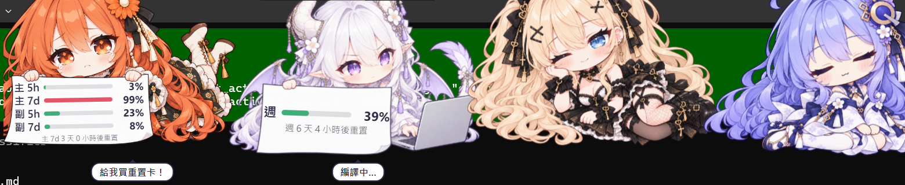

# quota-pets

[繁體中文](README.zh-TW.md)

A row of chibi characters that sits at the top of your Windows desktop. Each one holds a sheet of
paper with the subscription quota of its model family (Claude, GPT / Codex, Grok) or, for the
local Qwen coder, what its agent is doing. A character changes pictures when its agent is
working, when its quota runs out, and when it has been idle for a while.


On a real desktop, over Windows Terminal:



> **Status:** v0.10.1 is the last planned release. Fork it and change anything you like: the repo
> ships an [AGENTS.md](AGENTS.md) that walks a coding agent through the data backend, characters,
> poses, rules and layout.

## Features

- Transparent, always on top, not in the taskbar. Clicks on transparent pixels reach the window
  behind.
- Runs on built-in demo data until you point it at your own server.
- Poses picked by rules: working, quota empty, idle, offline, and any you add.
- Click a character for a line; now and then one speaks up on its own.
- Drag to move (snaps to the top center or top left), Ctrl + mouse wheel to zoom, and an adjust
  mode for lining up every picture and text box.
- Optional window binding: show the row only while chosen windows are in front.
- Interface in Traditional Chinese and English.
- Each character is one folder: its pictures plus a `character.json`.

## Install

1. Download `quota-pets-win-x64.zip` from
   [Releases](https://github.com/uraniumchonk/quota-pets/releases/latest) and unzip it anywhere.
2. Run `QuotaPets.exe`. It has a tray icon and no taskbar button.
3. The exe is not code-signed, so SmartScreen may warn the first time ("More info" → "Run anyway").

On first run the bundled `pets` folder is copied to `%APPDATA%\額度小人\pets`. That copy is yours:
edit pictures and settings there (right-click → "Open characters folder"). Saved changes show up
within about 0.3 s.

## Data source

`server` in `pets/config.json`:

- `"demo"` (default): no network at all. Cycles through calm, busy, empty and idle every 15 s.
- A base URL such as `"http://localhost:10026"`: reads `GET /api/quota` every 60 s and
  `GET /api/agents` every 20 s. The menu item "Refresh quota now" also sends `POST /api/refresh`.

The JSON format is in [docs/API.md](docs/API.md), and any small server can provide it. To try the
example one:

```sh
python3 tools/example_server.py 10026            # listens on 127.0.0.1 only
python3 tools/example_server.py 10026 0.0.0.0    # reachable from other machines, no authentication
```

It serves `tools/quota.json` and `tools/agents.json`, created with sample numbers on first use and
ignored by git. Edit them by hand, or replace `load()` with calls to each provider's usage API.
Keep provider keys on the server; the app never needs them.

The bundled characters read these keys:

| Folder | Character | Sign | `/api/quota` keys | `/api/agents` id |
|---|---|---|---|---|
| `claude` | orange hair | Main 5h, Main 7d, Alt 5h, Alt 7d | `claude`, `claude2` × `5h`, `7d` | `cli:claude` |
| `codex` | white dragon | Week | `codex` × `7d` | `cli:codex` |
| `grok` | gothic twin tails | Week | `grok` × `7d` | `cli:grok` |
| `qwen` | purple hair | Agent state and `doing` (local model, no quota) | none | `cli:qwen` |

When `/api/quota` fails for 3 polling periods in a row, every character switches to its offline
pose and keeps showing the last known numbers.

## Using it

| Action | Effect |
|---|---|
| Click a character | It says a line; an idle one wakes up for 10 s and shows its quota |
| Drag a character | Moves the whole row; snaps to the top center or top left within 48 px. The position starts locked: untick "Lock position" in the right-click menu first |
| Ctrl + mouse wheel on a character | Zooms the whole row in 5 % steps (menu "Size" has 50–150 % presets) |
| Right-click a character or the tray icon | Adjust, lock position, size, window binding, language, refresh, reload, open folder, start at login, developer tools, quit |

### Language

Right-click → "Language": System (default; Chinese systems get Traditional Chinese, all others
English), 繁體中文 or English. Stored as `lang` in `config.json` (`auto` / `zh-TW` / `en`).

### Window binding (optional, right-click → "Window binding")

By default the row is always visible. Once you bind windows, it appears only with them. You can
bind as many as you like.

- Quickest: focus a window (a terminal, say) and press **Ctrl+Alt+B**. A character says "Bound: …";
  press again to unbind. The first binding turns on "Show only with bound windows".
- "Bind a window" lists every open window; "Bind a program" covers all windows of one program.
- "Show while a bound window is in front" (default): the row hides about 0.2 s after you switch
  away or minimize (`hideDelaySec`). Clicking the characters does not count as switching away.
- "Show while a bound window is open": the row stays as long as any bound window exists.
- "Remove: …" drops one binding. Closed windows are marked "(closed)", and "Clear closed windows"
  removes them all. In adjust mode the row is always visible.

A single window is matched by its handle (hwnd). Reopening the window or restarting Windows gives
it a new handle, so bind it again. Tabs in one Windows Terminal window share a handle. Window
binding works on Windows only.

Bindings live in `bind` in `config.json`:

```json
"bind": { "enabled": true, "mode": "foreground", "hotkey": "Ctrl+Alt+B", "hideDelaySec": 0.2,
  "match": [ { "hwnd": 1312834, "process": "WindowsTerminal", "title": "claude" }, { "process": "Code" }, { "title": "Codex" } ] }
```

An entry with `hwnd` matches only that window (`process` and `title` are labels). Without `hwnd`,
`process` (program name, case-insensitive) and `title` (text the title contains) are compared;
when both are given, both must match.

### Adjust mode (right-click → "Adjust…")

Click a part, or press Tab (Shift+Tab backwards) to step through each character's image and sign
text box, then the ledge and the whole row. Dragging moves the selected part.

| Key | Character image | Sign text box | Ledge | Whole row |
|---|---|---|---|---|
| Arrows (Shift ×10) | Move 1 px | Move 1 image px | ↑↓ up/down, ←→ overhang | ↑↓ up/down, ←→ gap |
| Alt + arrows | ↑↓ size | Width, height | ↑↓ thickness | ↑↓ size 1 % |
| + / − | | Font size | | |
| [ / ] | | Rotate 0.5° (Shift ×10) | | |

- `P` / `Shift+P` previews the next / previous pose, so every picture can be aligned.
- "Own / shared box" gives the current pose its own text box, for a picture whose paper sits
  somewhere else.
- `Ctrl+S` saves and keeps editing. `Enter` saves, leaves adjust mode and locks the position.
  `Esc` discards the changes.
- To push heads past the top of the screen, select the whole row and press ↑ until "row y" is
  negative, or give one character image a negative y. The window stays at the top edge and cuts
  off the rest.

## Customizing characters

```
pets/
  config.json               server, polling, thresholds, character order, row placement, binding
  characters/<id>/
    character.json          name, quota rows, poses, rules, text box, lines
    normal.png              everyday, holding a blank sheet
    01_working.png          agent working (laptop and sheet)
    02_quota_empty.png      quota gone (crying, sheet)
    03_idle.png             idle (no sheet, no quota shown)
```

Each pose is one whole picture; changing pose swaps the picture. To replace art, overwrite a file
with a picture of the same size. To add a pose, add its picture, an entry in `poses` and a rule.
Poses share the character's `textBox`; a picture whose paper sits elsewhere gets its own
(`poses.<pose>.textBox`, as `working` and `critical` have). Press `P` in adjust mode to reach a
pose and align it.

Pictures can be png, gif, webp or apng; `.webm` and `.mp4` play looped and muted. All pictures of
one character share one size (`size`). Optional extras, unused by default: a pose can add `front`
(a second picture drawn in front of the ledge), and `rail.ledge.show: true` draws a shared ledge.

To add a character, create a folder under `characters/` with its pictures and a `character.json`
(copy an existing one), then add the folder name to `characters` in `config.json`. That list runs
left to right.

### Default rules

Checked top to bottom; the first match picks the pose.

1. Data server unreachable → `offline` (everyday picture, "Can't reach the server")
2. Agent not working, idle for 30 min or more, not clicked in the last 10 s → `idle` (no quota shown)
3. Any row at 90 % used or more → `critical` (`02_quota_empty`)
4. Agent working → `working` (`01_working`)
5. Any row at 75 % used or more → `warning` (everyday picture)
6. Otherwise → `normal`

For example, an idle pose late at night:

```json
{ "if": { "hours": [1, 7] }, "pose": "idle" }
```

### Rule conditions

Every condition in a rule's `if` must hold.

| Condition | Example | Meaning |
|---|---|---|
| `source` | `"offline"` | The data server has failed for more than 3 polling periods |
| `agentState` | `["sleeping", "offline"]` | The agent's state is one of these |
| `idleSecAtLeast` | `1800` | Not working, and the last activity was at least this many seconds ago |
| `severity` | `"warning"` | The tightest row is at least this level (thresholds in `config.json`, by used %) |
| `leftBelow` | `20` | Some row has less than 20 % left |
| `clickedWithinSec` | `10` | The character was clicked in the last 10 s |
| `hours` | `[1, 7]` | The hour is from 1 up to 7 (may wrap past midnight, e.g. `[23, 7]`) |
| `not`, `any` | `{ "not": { "clickedWithinSec": 10 } }` | Negation; any one of a list |

A new condition is one function in `QP.conditions` in `app/renderer/js/rules.js`.

### `character.json`

| Field | Meaning |
|---|---|
| `name` | Name shown in adjust mode |
| `size` | Picture size in pixels, e.g. `{ "w": 1448, "h": 1086 }`; every picture of the character has it |
| `scale`, `offset` | Size factor and position (screen pixels) |
| `agent` | Agent id in `/api/agents`; decides working, idle and asleep |
| `quota` | Rows on the sign: `provider` is a key in `/api/quota`, `window` a window id (`5h`, `7d`), `label` the text. An empty list shows the agent state instead |
| `footer` | `reset` shows a countdown to the reset of the tightest row; `state` shows none |
| `textBox` | Text box in picture pixels: `x y w h rotate fontSize color`, optional `font` |
| `poses` | Pose table. Each pose: `img`, `front`, `showQuota` (`false` hides quota), `text` (fixed text instead), `textBox` (a box for this pose only) |
| `rules` | Checked top to bottom; the first match picks the pose |
| `click` | `say` speaks when clicked; `pose` + `ms` switches to a pose for a moment |
| `lines` | Lines per pose, used for clicks and random chatter |

`name`, `label`, pose `text` and each pose's `lines` can be a single value or one per language:

```json
"label": { "zh-TW": "主 5h", "en": "Main 5h" }
```

Interface strings live in `app/i18n.json`; a new language is one more block with the same keys.

### `config.json`

| Field | Meaning |
|---|---|
| `server` | `"demo"` or the data server's base URL |
| `pollQuotaSec`, `pollAgentsSec` | Polling periods (60 and 20 s) |
| `thresholds` | `warning` and `critical` levels in used % (75 and 90) |
| `characters` | Character folders, left to right |
| `display` | `used` (default): numbers and bars show used %; `left`: remaining % |
| `lang` | `auto`, `zh-TW` or `en` |
| `rail` | Row placement: `anchor` (`top-center`, `top-left` or `free`), `x`, `y`, `shiftY`, `gap`, `scale`, `zoom`, `locked`, `ledge` |
| `bubble` | Random chatter: `enabled`, `autoSec` (seconds between lines, min and max), `showSec` |
| `bind` | Window binding, see above |
| `bundleVersion` | Version of the bundled `pets` folder; leave it alone |

### Upgrades

When a new build carries a higher `bundleVersion`, the old folder is renamed `pets.bak-<time>`, the
new characters and pictures are installed, and your tuning is carried over: placement, row size and
gap, zoom, lock, binding, server, language and used / left display, plus each character's
position, size and text boxes. A text box is carried over only while its pose still uses the same
picture file name.

## Privacy

- The app contacts only the `server` you configure; in demo mode it makes no network requests.
  There is no telemetry and no update check. The window loads only local files, and text from the
  server is shown as plain text.
- Settings stay in `%APPDATA%\額度小人`.
- On Windows, a hidden PowerShell process reads the titles and program names of open windows (on
  window events and every 2 s) so that window binding can work. They are kept in memory only.
  Binding a single window saves its handle, program name and title in `config.json`; removing the
  binding deletes them.
- `tools/example_server.py` has no authentication. Keep it on 127.0.0.1 unless you trust the
  network.

## Development

- `npm install && npm start` runs it with Electron on Windows, Linux or macOS (window binding is
  Windows only).
- Browser preview with fake data: `cd app && python3 -m http.server 18777`, then open
  `http://127.0.0.1:18777/renderer/index.html` (`?state=warning|critical|sleep`, `?edit=1`,
  `?lang=en`).
- `tools/package_win.sh` builds `dist/quota-pets-win-x64.zip` from the official Electron Windows
  build. It needs `curl`, `unzip` and `zip`; with `wine` and `dist/rcedit-x64.exe` it also sets the
  exe icon.
- Code map and conventions: [AGENTS.md](AGENTS.md).

## License

- Code: MIT ([LICENSE](LICENSE)).
- Character art (`app/pets/characters/**/*.png`): CC BY-NC 4.0 ([ART-LICENSE.md](ART-LICENSE.md)).
  The pictures were made with OpenAI's image model.
- Not affiliated with Anthropic, OpenAI, xAI or Alibaba. The characters are fan-made mascots
  themed after their model families.
